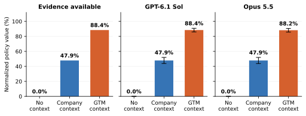
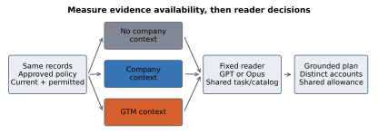

# Domain-Specialized Company Memory for Grounded Marketing Recommendations

**Guillaume Marquis · Research report and reproducible benchmark · October 2026**

[Read the paper](paper/report.pdf) · [Reproduce the results](release/REPRODUCING.md) · [Dataset](data/challenge/DATA_CARD.md) · [Raw results](analysis/challenge/main-v1/summary.json) · [Cite](CITATION.cff)

**How much does the context you give an AI assistant change its next-action recommendations?** We hold the reader fixed and compare no company context, general company context, and marketing-specialized context. This repository contains the code, fictional company histories, frozen protocols, actual model responses, scoring, analysis, figures and LaTeX paper.

**120 fictional companies · 360 multi-account scenarios · 4,320 actual GPT/Opus responses · 8 figures**



## What we found

With the same reader and bounded evidence allowance, marketing-specialized selection increases grounded decision value by about **40 percentage points** over our general company-context baseline. The gain comes mainly from presenting complete evidence chains to the model.

| Context given to the same reader | GPT-6.1 Sol | Claude Opus 5.5 |
| --- | ---: | ---: |
| No company evidence | 0.00% | 0.00% |
| General company context | 47.86% | 47.86% |
| Marketing-specialized context | **88.43%** | **88.19%** |
| Generic query-word selector | 88.43%* | 88.19%* |
| Full current company context, larger allowance | 99.96% | 98.06% |

**Metric:** fully grounded, feasible policy-priority value as a percentage of each positive case's full-information optimum, averaged equally by company. These are synthetic decision scores, not revenue lift or human preference. There are 288 positive cases and 72 negative cases; all treatments abstain on all negative cases. No-context zero is expected when a company-specific recommendation must cite company evidence.

The paired specialized-minus-general gains are **+40.6 points [36.7, 44.4]** for GPT and **+40.3 [36.3, 44.3]** for Opus; brackets are 95% company-clustered bootstrap intervals.

**The strongest control matters:** a generic query-word selector produces exactly the same 360 evidence packets as the specialized selector. The starred rows therefore reuse the same outputs and add zero independent observations. Wider generic contexts also close the retrieval gap. On a separate one-company development set, a general Markdown wiki answers **22/22** questions correctly versus **21/22** for a marketing wiki. The evidence supports better context selection under a budget; it does not establish universal superiority of a vertical architecture.

[All six executed treatments, costs and failure counts](paper/figures/challenge/results-table.tex) · [Every main response and request](experiments/challenge/main-reader-v1/) · [Qualitative error analysis](analysis/challenge/diagnostics.json)

## What the benchmark asks

Choose up to three marketing actions across several accounts under a shared resource limit. A valid recommendation must follow the current approved policy, connect account needs to an offering and its proof, satisfy action prerequisites, and cite its support. Cases include policy changes, conflicting observations, stale evidence and insufficient evidence.

We measure the best decision supported by the **retrieved context** separately from the decision the **reader actually returns**. The three stress levels combine 4/6/8 accounts with 16/12/8 KiB evidence allowances. Model settings, source hashes, attempts and amendments are retained.



The comparison includes a pinned native **GBrain search component**, general and specialized closure over its rankings, structured Markdown, full context, and the generic query-word control. GBrain is evaluated in one component configuration, not as a complete commercial product. The Markdown control is an original implementation inspired by file-based memory, not an official Karpathy product. See [attribution and versions](release/THIRD_PARTY.md).

## Try it without API keys

Python 3.12 is sufficient for these checks; no model, paid API, GPU or Python dependency installation is needed:

```sh
python3 -m unittest discover -s tests -v
python3 -m unittest study.test_contract study.test_ledger analysis.test_analysis analysis.test_audit -v
python3 -m benchmarks.challenge.check_oracle --data data/challenge/main-v1 --output oracle-check.json
python3 scripts/verify_report_claims.py
```

These check implementation contracts, all 360 formal labels against a separate SQL/exhaustive solver, and the numeric claim register. They do **not** rerun model inference.

For full saved-output reproduction, including the paper and all figures:

```sh
python3 -m venv .venv-analysis
.venv-analysis/bin/python -m pip install --require-hashes -r release/requirements-analysis.lock
.venv-analysis/bin/python scripts/reproduce_saved.py --output ../marketing-memory-reproduction
```

Use a new output directory. System LaTeX/BibTeX, Pandoc and Poppler are also required. The command verifies `MANIFEST.json`, rebuilds the datasets and contexts, rescores saved responses, regenerates statistics and figures, and recompiles both PDFs. It makes **zero provider requests**. [Install details, fresh model runs and native retrieval](release/REPRODUCING.md) distinguish cached-result verification from a new paid experiment.

The complete evidence tree is approximately 1.3 GB uncompressed; each individual file is below GitHub's 100 MiB limit. Large embedding snapshots are losslessly sharded. Historical studies and failed attempts are included in separate directories, not pooled with the current experiment.

## Navigate the evidence

| Path | Contents |
| --- | --- |
| [`paper/`](paper/) | Current 13-page report, LaTeX/BibTeX, vector figures and two-page investor note |
| [`benchmarks/challenge/`](benchmarks/challenge/) | Generator, context methods, common reader runner, scorer and reference solver |
| [`data/challenge/`](data/challenge/) | Fictional worlds, labels, splits and data card |
| [`experiments/challenge/`](experiments/challenge/) | Frozen inputs, every request/response, usage, timings, pilot and main |
| [`analysis/challenge/`](analysis/challenge/) | Paired results, uncertainty, budget sweeps, failures and external extension |
| [`papers/company-memory/protocol/`](papers/company-memory/protocol/) | Protocol, prospective changes and declared analysis choices |
| [`literature/`](literature/) | Bounded search log, critical reviews and reuse decisions |
| [`release/`](release/) | Reproduction instructions, exact-payload receipts, licenses and archived studies |

## Scope, costs and contributions

This is an AI-assisted industrial technical report on synthetic, schema-controlled histories. It has no independent practitioner panel, observed campaign outcomes or peer-review claim. Main inference cost is **$147.68**; the whole new study is **$183.66**, calculated from saved usage and dated list prices. These are not invoices or full system operating costs. [The paper](paper/report.pdf) and [publication status](release/PUBLICATION_STATUS.md) give the full boundaries.

Useful extensions include independently authored histories, stronger generic baselines, raw-document ingestion, alternative context budgets and blinded expert evaluation. Please retain the frozen originals and add new versioned runs. See [contributing](CONTRIBUTING.md).

## License and citation

Original code: [MIT](LICENSE). Specified original data, outputs and documentation: [CC BY 4.0](LICENSE-DATA). External documents retain their upstream MIT license and credits. Models and API access are not redistributed. No customer records, private planning history, credentials or model weights are included.

```bibtex
@techreport{marquis2026specializedmemory,
  author = {Marquis, Guillaume},
  title = {Domain-Specialized Company Memory for Grounded Marketing Recommendations},
  year = {2026},
  institution = {Pancake},
  note = {AI-assisted industrial technical report},
  url = {https://github.com/get-pancake/marketing-memory-benchmark}
}
```

[Machine-readable citation](CITATION.cff) · [Third-party credits](release/THIRD_PARTY.md)
